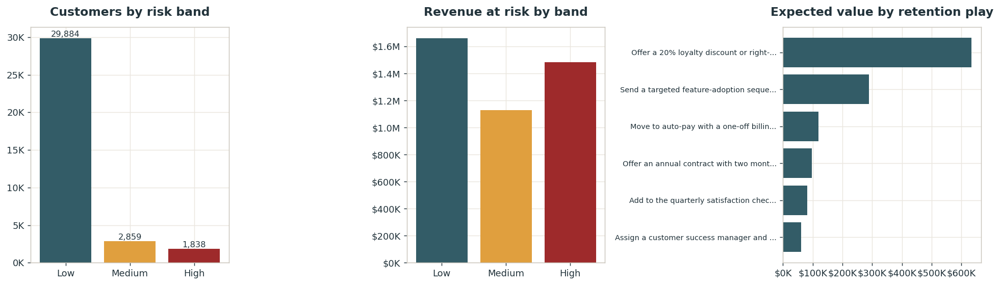
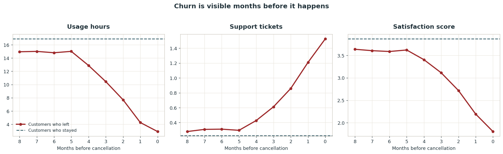
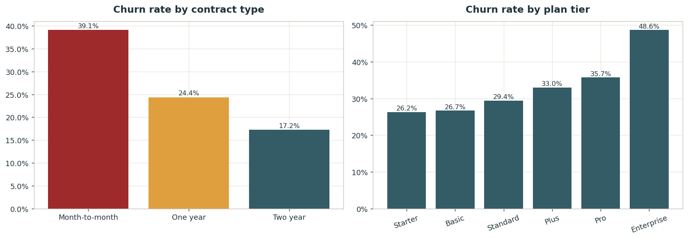
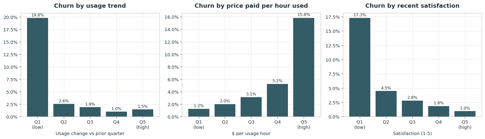
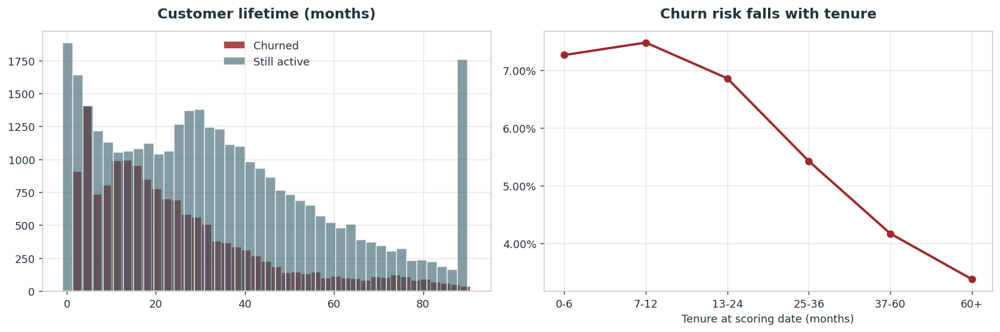
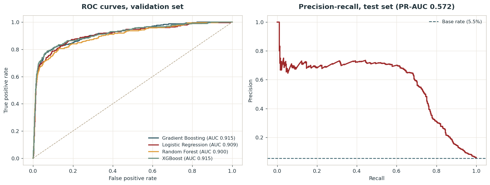
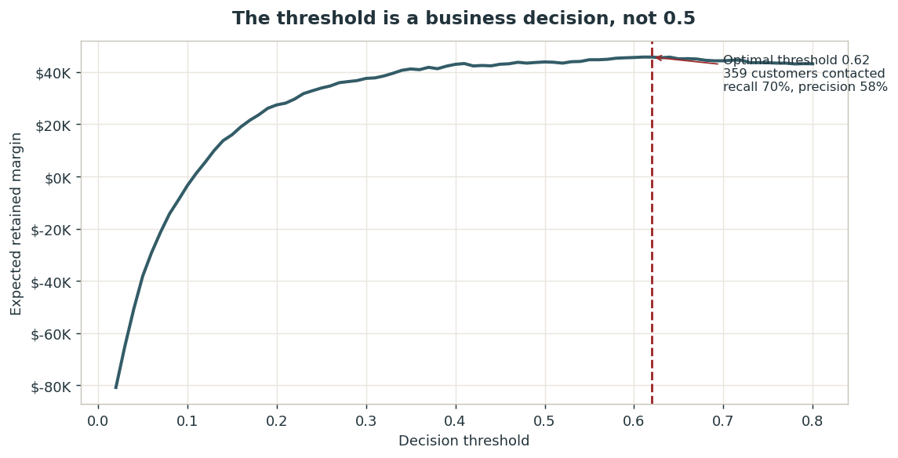
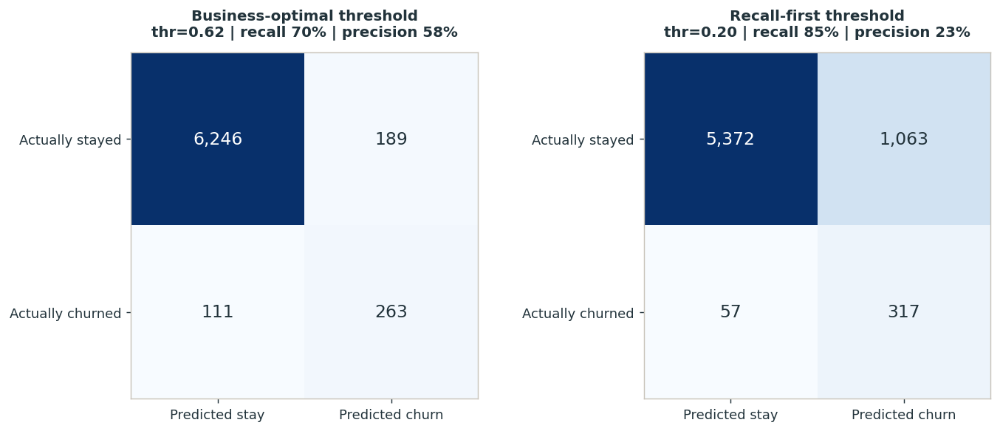
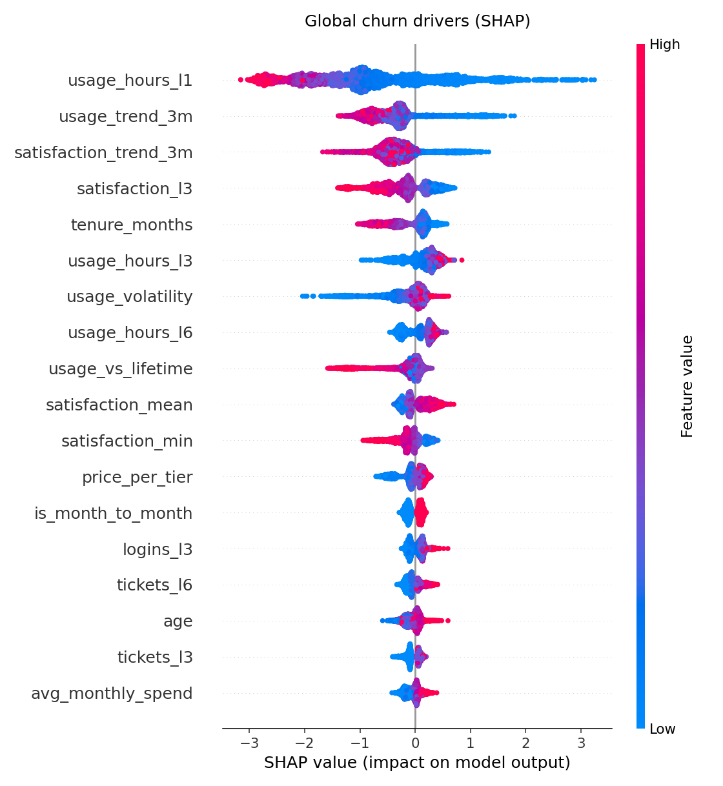
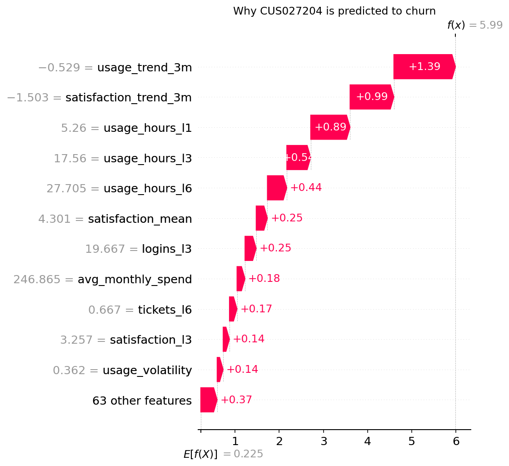

# Customer Churn Prediction & Retention Intelligence Platform

An end-to-end churn system for a subscription business: a simulated 24-month customer
history, a SQL warehouse, a leakage-safe feature pipeline, four benchmarked models, SHAP
explanations translated into plain English, and a Streamlit dashboard that turns a
probability into a named retention play with an owner and a cost.

> **1,838 customers — 5% of the book — carry a 91% average probability of cancelling this
> quarter and $1.62M of annual recurring revenue. Working that list is worth an expected
> $554K net of programme cost, a 3.4x return.**

---

## Contents

1. [The business problem](#the-business-problem)
2. [Results at a glance](#results-at-a-glance)
3. [Architecture](#architecture)
4. [The dataset](#the-dataset)
5. [Data pipeline](#data-pipeline)
6. [What the data says](#what-the-data-says)
7. [Modelling](#modelling)
8. [Explainability](#explainability)
9. [From probability to action](#from-probability-to-action)
10. [Dashboard](#dashboard)
11. [Running it](#running-it)
12. [Project structure](#project-structure)
13. [Design decisions worth defending](#design-decisions-worth-defending)
14. [What I would do next](#what-i-would-do-next)

---

## The business problem

Subscription businesses lose customers every month and usually find out on the day the
cancellation lands — far too late to do anything about it. The retention team needs three
answers, not one:

| Question | What this project delivers |
|---|---|
| Who is likely to leave? | A calibrated probability for every active customer, over a 3-month horizon |
| Why are they leaving? | Per-customer SHAP drivers, rendered as sentences an agent can read on a call |
| What should we do? | A rule-based play with a named owner, a cost, and an expected value |

A model that answers only the first question gets ignored. An agent handed "82% likely to
churn" with no reason and no script has nothing to act on.

---

## Results at a glance

**Model performance** — held-out test set, 6,809 customers, 5.5% base rate:

| Metric | Business-optimal threshold (0.62) | Recall-first threshold (0.20) |
|---|---|---|
| Recall | **70.3%** | **84.8%** |
| Precision | 58.2% | 23.0% |
| F1 | 0.637 | 0.361 |
| ROC-AUC | 0.914 | 0.914 |
| PR-AUC | 0.572 | 0.572 |

- **5-fold cross-validated ROC-AUC: 0.9145 ± 0.0042** — stable, not a lucky split.
- **76% of all churners sit in the top 10%** of scored customers; 85% in the top 20%.
- Brier score 0.051, and the calibration curve tracks the diagonal — the probabilities mean
  what they say, which matters because CLV and revenue-at-risk multiply by them.

**Business impact** — 34,581 active customers, $26.1M ARR:

| | Customers | Share | ARR at risk | Avg probability |
|---|---|---|---|---|
| Low risk (0–30%) | 29,884 | 86.4% | $1.66M | 7% |
| Medium risk (30–70%) | 2,859 | 8.3% | $1.13M | 45% |
| **High risk (70–100%)** | **1,838** | **5.3%** | **$1.48M** | **91%** |

Targeting the 4,697 customers above 30% risk costs an estimated **$229K** and is expected to
save **$783K** of revenue — a **net $554K, or 3.4x**.



---

## Architecture

```
┌─────────────────┐
│  Simulator      │  latent traits → monthly behaviour → churn hazard → disengagement
│ data_generator  │  50,000 customers × 24 months, deliberately dirty output
└────────┬────────┘
         │  data/raw/*.csv
┌────────▼────────┐
│  Transform      │  dedupe, standardise, winsorise, impute  →  customer-month panel
│ preprocessing   │  time-cutoff feature engineering (49 numeric + 6 categorical)
└────┬───────┬────┘
     │       │
     │  ┌────▼──────────┐
     │  │  Warehouse    │  star schema: 3 dimensions, 5 facts
     │  │  etl_load     │  SQLite by default, PostgreSQL via CHURN_DB_URL
     │  └───────────────┘
     │  features_train.parquet  /  features_score.parquet
┌────▼────────────┐
│  Model          │  LogReg · RandomForest · GradientBoosting · XGBoost
│  model.py       │  class weights, PR-AUC selection, economic threshold
└────────┬────────┘
         │  churn_model.pkl
    ┌────▼─────┬──────────────┐
    │ explain  │  predictions │  SHAP drivers  +  risk bands, CLV, playbook
    └────┬─────┴──────┬───────┘
         │            │
┌────────▼────────────▼────────┐
│  Streamlit dashboard         │  executive overview · risk explorer · model performance
└──────────────────────────────┘
```

---

## The dataset

Public churn datasets are cross-sectional — one row per customer, a flag, no history. You
cannot demonstrate a time-aware model, a leakage-safe cutoff, or behaviour changing before a
cancellation on top of them. So the data is simulated, with the process made explicit.

| Table | Grain | Rows |
|---|---|---|
| `customers.csv` | customer | 50,000 (+600 duplicate rows) |
| `plans.csv` | plan tier × contract | 18 |
| `usage.csv` | customer-month | 835,813 |
| `payments.csv` | customer-month | 835,813 |
| `support.csv` | ticket | 243,821 |
| `status.csv` | customer | 50,000 |

**Churn is never sampled from a label column.** Each month, every active customer draws a
Bernoulli event whose log-odds are a function of observable things — contract type, chronic
ticket pressure, usage decline, late payments, satisfaction, tenure, and the gap between
price paid and usage taken — plus an **unobserved frailty term deliberately withheld from the
feature table**. That hidden variance is what keeps achievable AUC realistic instead of the
suspicious 0.99 that leaky synthetic data produces.

Churn happens in **two stages**, because customers rarely cancel out of nowhere:

```
healthy → [hazard fires] → disengagement phase (2–5 months) → cancel
                                     └── 20% recover unaided → back to healthy
```

During disengagement, usage decays ~34% per month, tickets rise, satisfaction slides. The
20% who recover are the honest false positives that stop the problem being trivially
separable.

Overall churn across the window: **30.8%**. Stated reasons, weighted by the revenue that
walked out:

| Reason | Customers | Annualised revenue lost |
|---|---|---|
| Too expensive | 2,755 | $4.23M |
| Found competitor | 4,124 | $4.12M |
| Poor customer service | 2,565 | $2.04M |
| Missing features | 2,783 | $1.95M |
| Not using service | 1,782 | $1.34M |
| Technical problems | 1,410 | $1.12M |

The ranking flips depending on how you count. *Found competitor* loses the most customers;
*too expensive* loses the most money, because it concentrates in higher-priced plans. A
retention budget allocated on customer counts would be aimed at the wrong problem.

---

## Data pipeline

### Extract
The raw layer arrives the way a production export really does — and every defect is
repaired and **counted**, so the work is auditable:

| Defect | Repaired |
|---|---|
| Duplicate customer rows (double load) | 600 |
| Impossible ages (0, 1, 199, 250) | 60 |
| Missing ages imputed by segment median | 1,275 |
| Missing income levels | 1,713 |
| Payment-method spelling variants collapsed (`CC`, `credit card`, `Credit Card`…) | 10 → 5 |
| Refunds booked as negative payments | 834 |
| Missing payment amounts | 3,365 |
| Missing usage readings | 4,910 |
| Instrumentation spikes winsorised at p99.9 | 836 |

Outliers are **winsorised, not deleted**. The customer-month still happened; only the
magnitude is untrustworthy. Dropping the row would quietly remove a real customer from the
denominator of every churn rate downstream.

### Transform
Cleaned facts are joined into a **customer-month panel**, then aggregated into features
across four windows (lifetime, last 1 / last 3 / prior 3 / last 6 months):

| Family | Examples |
|---|---|
| Tenure & contract | `tenure_months`, `is_month_to_month`, `new_customer_flag` |
| Engagement level | `usage_hours_l3`, `logins_l3`, `feature_usage_l3` |
| Engagement trend | `usage_trend_3m`, `usage_vs_lifetime`, `usage_volatility` |
| Support pressure | `tickets_l6`, `support_frequency`, `critical_tickets_total` |
| Satisfaction | `satisfaction_l3`, `satisfaction_trend_3m`, `satisfaction_min` |
| Billing | `late_payment_rate`, `discount_rate`, `spend_trend_3m` |
| Value for money | `revenue_per_usage_hour`, `price_per_tier`, `data_utilisation` |

**The cutoff is the most important line in the project:**

```
months 1 .............. 21 │ 22  23  24
    features built here    │  label observed here
                        cutoff
```

A customer enters the training table only if they were still active at the end of month 21.
Features summarise months 1–21; the label is cancellation in months 22–24. The windows do
not overlap, so no feature can encode the outcome. The **same function**, pointed at the
last month with `horizon=None`, builds the scoring table — training and serving cannot drift
apart because they are one code path.

There is a test for this. `test_features_use_no_post_cutoff_data` rebuilds every feature from
a panel physically truncated at the cutoff and asserts the two tables are identical.

Result: **34,044 customers for training, 5.49% positive rate (1,869 churners)**, and 34,581
active customers to score.

### Load
Star schema into SQLite by default (zero setup) or PostgreSQL via `CHURN_DB_URL`. Same table
names, so the same SQL runs against either. `sql/analysis_queries.sql` holds ten analytical
queries — cohort retention, window-function alignment of behaviour against cancellation
dates, revenue-weighted reason analysis, and the retention call list.

---

## What the data says

### Churn is visible months before it happens



Aligning every churned customer on their cancellation month:

| Months before cancellation | 8 | 6 | 4 | 2 | 0 |
|---|---|---|---|---|---|
| Usage hours | 14.9 | 14.8 | 12.9 | 7.7 | 2.9 |
| Support tickets | 0.28 | 0.31 | 0.43 | 0.86 | 1.53 |
| Satisfaction | 3.64 | 3.59 | 3.40 | 2.72 | 1.81 |

Usage falls **80%**, tickets rise **5x**, satisfaction drops nearly two points. Customers who
stay are flat on all three. The deterioration is gradual and starts months ahead — there is
time to intervene, which is the entire premise of the system.

### Contract type is the largest structural lever



| Contract | Churn rate | Annualised revenue lost |
|---|---|---|
| Month-to-month | **39.1%** | $9.33M |
| One year | 24.4% | $3.82M |
| Two year | 17.2% | $1.65M |

Month-to-month customers churn at **2.3x** the rate of two-year contracts. Unlike
satisfaction or usage, this is something commercial can act on directly.

### It is the value gap, not the price



Price band moves churn modestly (3.2% → 4.9% across quintiles). **Price paid per hour
actually used** moves it nearly 3x (2.0% → 5.9%). The implication is not "cut prices" — it is
"move under-using customers onto the right plan, or get them using what they already pay
for". Usage intensity tells the same story: churn falls from **42.6% in the lowest usage
quintile to 15.7% in the highest**.

### Risk is front-loaded



Customers in their first six months carry roughly **double** the forward churn risk of a
three-year relationship. Onboarding is a retention programme, not a marketing one.

---

## Modelling

Four models, class-weighted rather than resampled, selected on **PR-AUC** because with a 5.5%
positive class ROC-AUC is flattered by the enormous number of true negatives:

| Model | ROC-AUC | PR-AUC | Recall | Precision | Brier | Top-decile capture |
|---|---|---|---|---|---|---|
| **XGBoost** | 0.915 | **0.549** | 0.729 | 0.498 | 0.051 | 77% |
| Gradient Boosting | 0.915 | 0.516 | 0.779 | 0.390 | 0.073 | 76% |
| Random Forest | 0.900 | 0.515 | 0.676 | 0.493 | 0.061 | 72% |
| Logistic Regression | 0.909 | 0.503 | 0.786 | 0.307 | 0.094 | 72% |



The logistic regression is not embarrassed here — within half a point of the boosted models
on ROC-AUC. That is a useful reminder that most of the work was done in feature engineering,
not model selection.

### The threshold is a business decision, not 0.5



0.5 assumes a false positive and a false negative cost the same. They do not:

```
value of a catch = monthly revenue × gross margin × expected lifetime × save rate
cost of a flag   = monthly revenue × offer discount × months honoured
```

Maximising expected retained margin on the **validation** set puts the optimum at **0.62** —
1,048 customers contacted, 70% recall at 58% precision. The peak is where an extra retention
call stops paying for itself. A recall-first alternative at 0.20 catches 85% of churners but
wastes three offers in four; the dashboard lets a stakeholder move the slider and watch the
confusion matrix update.



---

## Explainability



Global drivers, by mean absolute SHAP value:

| Rank | Feature | What it means |
|---|---|---|
| 1 | `usage_hours_l1` | Last month's engagement |
| 2 | `usage_trend_3m` | Quarter-on-quarter usage change — disengagement, measured |
| 3 | `satisfaction_trend_3m` | Direction of travel beats level |
| 4 | `satisfaction_l3` | Recent satisfaction |
| 5 | `tenure_months` | Relationship length |

The model rediscovered the disengagement story the EDA found, without being told it.

But global importance does not help an agent on a call. `src/explain.py` renders each
customer's SHAP contributions as sentences:

```
Customer CUS027204 — Enterprise Month-to-month — churn probability 99.8%

Pushing towards leaving                              SHAP
  + Usage down 53% versus the prior quarter         +1.39
  + Satisfaction down 1.5 points                    +0.99
  + Last month's usage was 5.3 hours                +0.89
  + Six-month average usage of 27.7 hours/month     +0.44

Holding them in place
  − 39 months as a customer                         −0.08
  − Spend up 5% versus the prior quarter            −0.08
  − Recent usage is 53% of this customer's own norm −0.05

Recommended play: offer a 20% loyalty discount or right-size the plan (Retention desk)
```

A long-tenured Enterprise account whose usage has collapsed from 27.7 hours a month to 5.3,
with satisfaction falling a point and a half. Tenure is the only thing holding them, and it
is nowhere near enough to offset the collapse.



SHAP values are additive in log-odds space, so those contributions genuinely sum to the
score — this is a decomposition, not a post-hoc rationalisation.

---

## From probability to action

### CLV, and the trap in the obvious formula

The textbook shortcut — `monthly revenue × expected lifetime` — quietly breaks the business
case. A customer about to cancel has a *short* expected lifetime, so a small CLV, so the
model recommends **ignoring the most urgent accounts in the book**. This project hit exactly
that: the first version scored high-risk customers at *negative* expected value.

The fix is to value a save against the counterfactual — what the customer is worth **if the
intervention works** and they revert to healthy-book behaviour:

```
monthly hazard   h = 1 − (1 − p_horizon)^(1 / horizon_months)
survival factor  q = (1 − h) / (1 + discount_rate)
CLV                = monthly_margin × q / (1 − q)
CLV if retained    = same formula at a healthy 2% monthly hazard
```

Average expected value per customer now rises with risk — High $395, Medium $203, Low $0 —
which is the behaviour a retention desk needs. There is a test asserting this ordering holds.

### The playbook

Rules read the same features SHAP surfaces as drivers, so the recommendation always matches
the stated reason for the risk. Each play carries an owner, a cost and an expected value:

| Trigger | Play | Owner |
|---|---|---|
| High risk + large value gap or expensive plan in decline | Offer a 20% loyalty discount or right-size the plan | Retention desk |
| High risk + heavy support load or low satisfaction | Assign a CSM and run a support review | Customer Success |
| High risk + usage falling or low feature adoption | Re-onboarding campaign with a guided walkthrough | Lifecycle Marketing |
| High risk + month-to-month | Annual contract with two months free | Retention desk |
| Late payments | Auto-pay with a one-off billing credit | Billing operations |
| Medium risk | Adoption sequence or satisfaction check-in | Lifecycle / Account management |
| Low risk, high CLV, near data limit | Flag as an expansion candidate | Sales |

Across the 1,838 high-risk customers: 1,290 price-relief offers, 438 CSM assignments, 95
re-onboarding campaigns, 13 contract conversions, 2 billing fixes.

---

## Dashboard

```bash
streamlit run dashboard/app.py
```

**Executive overview** — ARR at risk, risk distribution, churn trend against revenue lost,
exposure by segment, and the retention plan ranked by expected value.

**Customer risk explorer** — search any customer, see the profile, a risk gauge, the signed
SHAP driver ledger, protective factors, and the recommended play with its economics. Exports
a prioritised call list as CSV.

**Model performance** — model comparison, ROC curves, SHAP importance, the expected-value
curve, and a **live threshold slider** that recomputes the confusion matrix on the held-out
test set so a stakeholder can see the recall/precision trade-off for themselves.

All three pages are covered by a headless smoke test (`streamlit.testing.v1.AppTest`).

---

## Running it

```bash
git clone <repo> && cd customer-churn-project
python -m venv .venv && source .venv/bin/activate
pip install -r requirements.txt

python src/run_pipeline.py          # full rebuild, ~6 minutes
streamlit run dashboard/app.py
```

Useful flags: `--skip-data` reuses the existing extracts, `--skip-db` skips the warehouse
load, `--customers 5000` runs a fast subset.

Against PostgreSQL:

```bash
psql -d churn_dw -f database/schema.sql
CHURN_DB_URL=postgresql+psycopg2://user:pw@localhost:5432/churn_dw python src/etl_load.py
```

Tests: `pytest tests/ -v` (22 tests, ~5s).

The notebooks are committed **with outputs**, so the analysis is readable on GitHub without
running anything.

---

## Project structure

```
customer-churn-project/
├── data/
│   ├── raw/            generated extracts (gitignored)
│   ├── processed/      cleaned parquet, feature tables, scored customers
│   └── sample/         3,000-customer sample, committed so the repo is browsable
├── notebooks/
│   ├── 01_data_generation.ipynb    the simulator and why it exists
│   ├── 02_data_cleaning.ipynb      repairs, the panel, the leakage cutoff
│   ├── 03_EDA.ipynb                five business questions, answered
│   ├── 04_model_training.ipynb     four models, threshold economics, gains curve
│   └── 05_SHAP_analysis.ipynb      drivers, segmentation, CLV, the playbook
├── src/
│   ├── config.py           every path and constant in one place
│   ├── data_generator.py   two-stage churn simulator
│   ├── preprocessing.py    cleaning + time-cutoff feature engineering
│   ├── etl_load.py         warehouse load (SQLite / PostgreSQL)
│   ├── model.py            training, comparison, threshold optimisation
│   ├── explain.py          SHAP + the plain-English driver layer
│   ├── predictions.py      scoring, risk bands, CLV, retention playbook
│   ├── visualisation.py    every figure in this README
│   └── run_pipeline.py     orchestrator
├── database/schema.sql     star schema DDL + reporting views
├── sql/analysis_queries.sql ten analytical queries
├── dashboard/app.py        three-page Streamlit application
├── models/                 trained pipeline + metadata
├── reports/                metrics, summary tables, figures
├── tests/test_pipeline.py  22 tests
└── requirements.txt
```

---

## Design decisions worth defending

| Decision | Reasoning |
|---|---|
| Simulated data over a public dataset | Cross-sectional data cannot demonstrate time-aware features, a leakage cutoff, or pre-churn behaviour |
| Frailty term hidden from features | Real churn is partly unobservable; including it would manufacture a fake 0.99 AUC |
| Class weights, not SMOTE | Synthesising minority points at a 5% base rate inflates validation scores without improving ranking — and ranking is what the desk consumes |
| PR-AUC for model selection | ROC-AUC is flattered by true negatives at this base rate |
| Threshold from expected value | 0.5 assumes symmetric costs; a missed churner costs ~13x a wasted offer here |
| Winsorise outliers, don't drop rows | Dropping removes real customers from every downstream denominator |
| Counterfactual CLV for save value | Current CLV already prices in the customer leaving, which inverts the targeting logic |
| One feature function for train and score | Training/serving skew is a silent killer; sharing the code path removes the class of bug |
| Notebooks as narrative, `src/` as library | Notebooks explain; modules are tested and reusable |

---

## What I would do next

- **Uplift modelling.** This ranks who *will* leave, not who can be *persuaded to stay*. Some
  high-risk customers are already gone; some low-risk ones would be irritated by an offer. A
  treatment-effect model on A/B'd campaigns is the honest next step, and it is the single
  biggest available gain.
- **Survival analysis.** A discrete-time hazard or Cox model gives time-to-event rather than a
  fixed 3-month window, which fits contract-renewal timing better.
- **Close the feedback loop.** Log every offer and outcome so the 30% save rate stops being an
  assumption and becomes a measurement.
- **Monitoring.** Feature drift on the scoring table, monthly calibration backtests, and an
  alert when precision at the operating threshold breaches its lower control limit.
- **Cost sensitivity.** The business case rests on gross margin, save rate and offer cost. A
  tornado chart over plausible ranges would show how much of the $554K survives pessimistic
  assumptions.

---

*Built with Python, pandas, scikit-learn, XGBoost, SHAP, SQLAlchemy, Plotly and Streamlit.*
